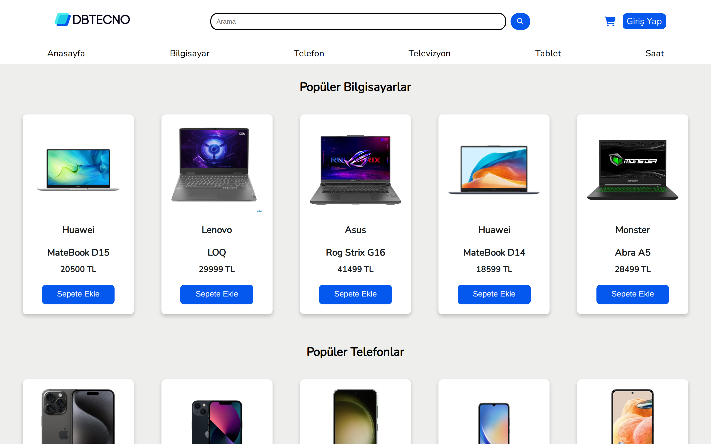
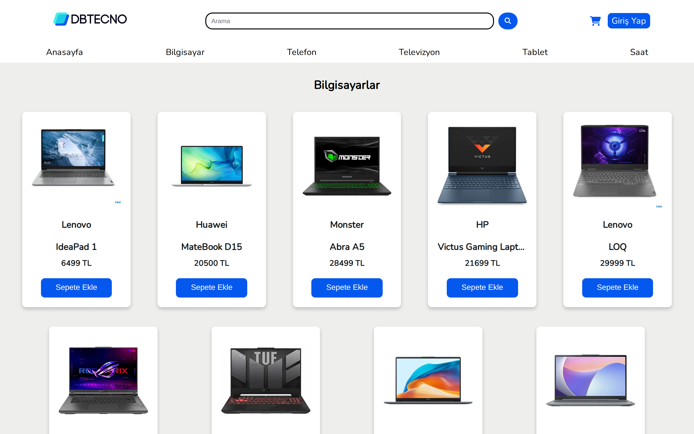
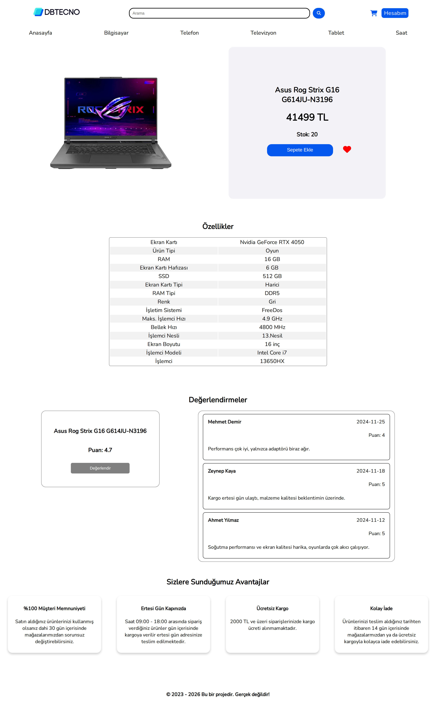
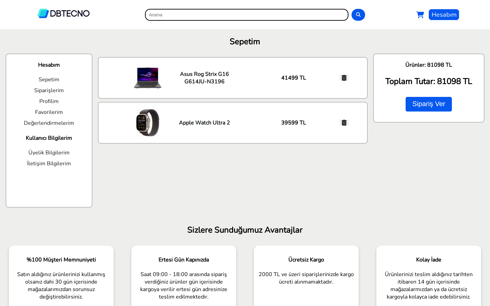
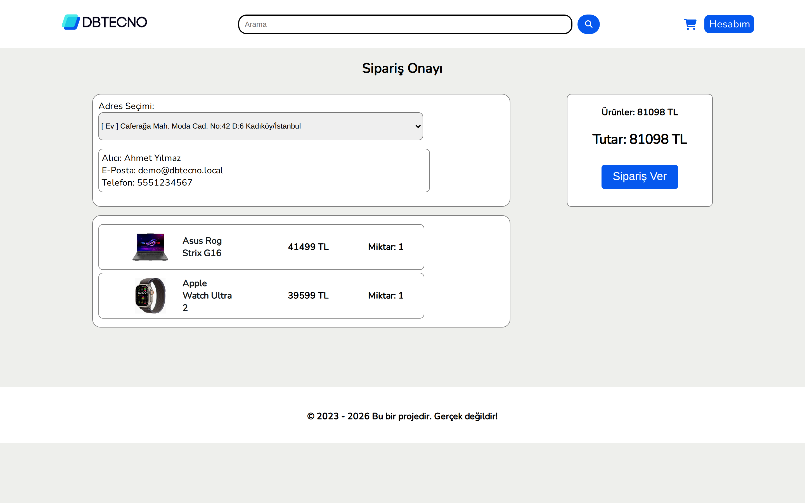
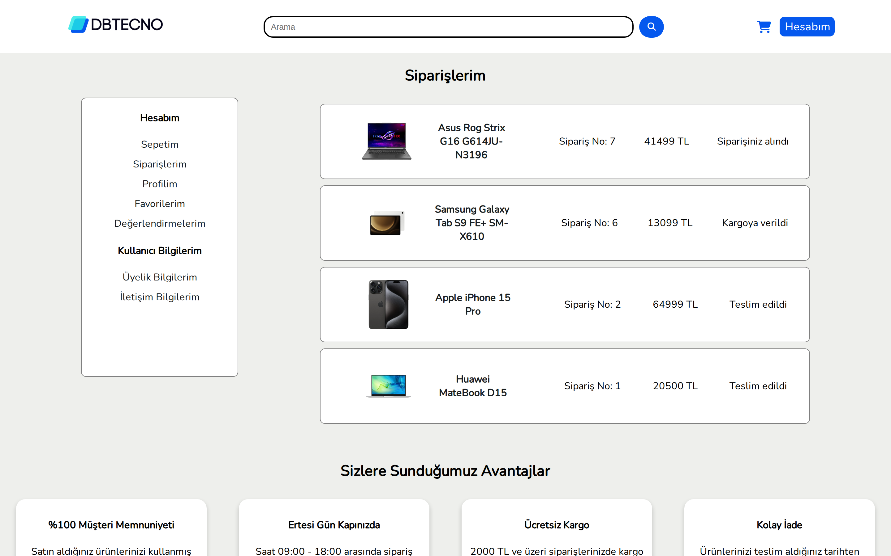
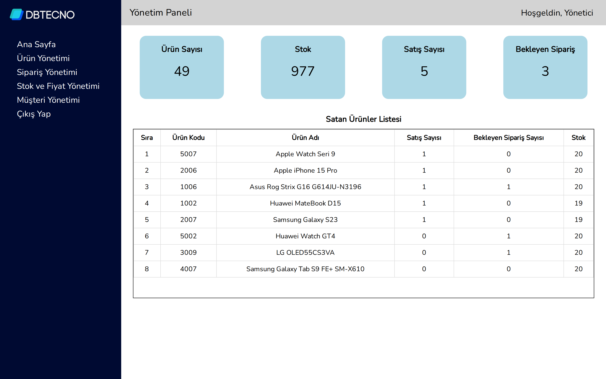
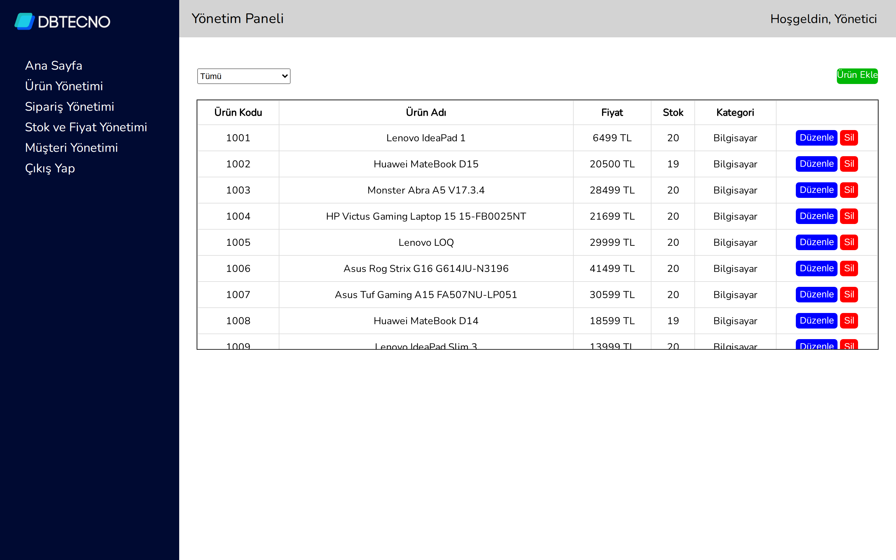
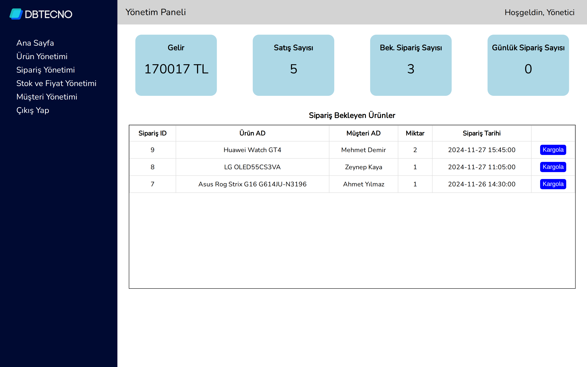

# DBtecno

**DBtecno**, PHP ve MySQL kullanılarak geliştirilmiş, teknoloji ürünleri (bilgisayar, telefon, televizyon, tablet ve akıllı saat) odaklı bir e-ticaret web uygulamasıdır. Müşteri vitrini, sepet ve sipariş akışı ile kapsamlı bir yönetici paneli içerir.

## Özellikler

### Müşteri Tarafı
- **Kategori ve Ürün Vitrini:** 5 farklı teknoloji kategorisinde ürün listeleme, ana sayfada değerlendirme puanına göre popüler ürün seçkileri ve ürün arama.
- **Ürün Detay ve Değerlendirmeler:** Kategoriye özel teknik özellik tablosu, ortalama puan gösterimi, kullanıcı yorumları ve favorilere ekleme.
- **Üyelik ve Profil Yönetimi:** Kayıt olma, oturum açma, şifre/iletişim bilgileri güncelleme ve birden fazla teslimat adresi tanımlama.
- **Sepet ve Sipariş Akışı:** Sepete ürün ekleme/çıkarma, kayıtlı adres seçerek sipariş oluşturma ve sipariş durumunu takip etme.

### Yönetici Paneli (`/admin`)
- **Özet Dashboard:** Toplam ürün, stok, tamamlanan satış, bekleyen sipariş sayıları ve en çok satan ürünler tablosu.
- **Ürün Yönetimi:** Yeni ürün ekleme, teknik özellikleri güncelleme ve ürün silme.
- **Sipariş Yönetimi:** Toplam gelir, günlük/bekleyen sipariş takibi ve siparişleri kargolama.
- **Stok ve Fiyat Yönetimi:** Ürün bazlı stok güncelleme ve fiyat takibi.
- **Müşteri Yönetimi:** Kayıtlı müşteri listesi, günlük giriş istatistikleri ve hesap aktif/pasif durumu kontrolü.

## Kullanılan Teknolojiler

- **Backend:** PHP 8.2+ (`mysqli`, `curl`)
- **Veritabanı:** MySQL 5.7+ / 8.0 veya MariaDB
- **Frontend:** HTML5, CSS3, Vanilla JavaScript (Fetch API), Font Awesome, Nunito Font
- **Konteynerizasyon:** Docker & Docker Compose

## Klasör Yapısı

```text
dbtecno/
├── admin/                  # Yönetici paneli sayfaları ve yardımcıları
│   └── partials/           # Admin menü, header ve AJAX işlem uçları
├── css/                    # Vitrin, giriş ve kayıt stilleri
├── icons/                  # Arayüz SVG ikonları
├── image/                  # Ürün görselleri
├── libs/                   # Yardımcı fonksiyonlar, sınıflar ve AJAX uçları
├── logo/                   # Uygulama logoları
├── Nunito/                 # Yerel font dosyaları
├── pages/                  # Ürün detay, arama, sepet, sipariş ve profil sayfaları
├── parts/                  # Ortak şablon parçaları ve veritabanı yapılandırması
├── screenshots/            # Uygulama ekran görüntüleri
├── dbtecnoc_db.sql         # Veritabanı şeması ve örnek demo verileri
├── docker-compose.yml      # Docker geliştirme ortamı yapılandırması
├── .env.example            # Örnek ortam değişkenleri
├── index.php               # Ana sayfa ve kategori listeleme
├── login.php               # Müşteri girişi
└── signup.php              # Müşteri kaydı
```

## Lokal Kurulum

### Seçenek 1: Docker Compose ile Kurulum

1. Depoyu klonlayın ve ortam dosyalarını oluşturun:
   ```bash
   git clone https://github.com/b11s3c/dbtecno.git
   cd dbtecno
   cp .env.example .env
   cp parts/config.example.php parts/config.php
   ```
2. İsterseniz `.env` dosyasındaki veritabanı şifrelerini düzenleyin.
3. Konteynerleri başlatın (`dbtecnoc_db.sql` ilk başlatmada otomatik olarak içe aktarılır):
   ```bash
   docker compose up -d
   ```
4. Tarayıcıdan erişin:
   - **Mağaza:** `http://localhost:8085`
   - **Admin Paneli:** `http://localhost:8085/admin`
   - **phpMyAdmin:** `http://localhost:8086`

### Seçenek 2: Manuel Kurulum (PHP + MySQL / MariaDB)

**Gereksinimler:** PHP 8.2+ (`mysqli`, `curl` eklentileri aktif) ve MySQL 5.7+ / MariaDB 10.6+

1. Veritabanını oluşturun ve `dbtecnoc_db.sql` dosyasını içe aktarın:
   ```bash
   mysql -u root -p -e "CREATE DATABASE dbtecnoc_db CHARACTER SET utf8mb4 COLLATE utf8mb4_unicode_ci;"
   mysql -u root -p dbtecnoc_db < dbtecnoc_db.sql
   ```
2. Örnek yapılandırma dosyasını kopyalayın ve kendi veritabanı bilgilerinizi girin:
   ```bash
   cp parts/config.example.php parts/config.php
   ```
3. PHP geliştirme sunucusunu proje kök dizininde başlatın:
   ```bash
   php -S 127.0.0.1:8085
   ```
4. Tarayıcıdan `http://127.0.0.1:8085` adresini açın.

## Demo Hesap Bilgileri

`dbtecnoc_db.sql` içe aktarıldığında aşağıdaki test hesapları hazır gelir:

| Rol | E-Posta | Şifre | Giriş Adresi |
| --- | --- | --- | --- |
| Müşteri | `demo@dbtecno.local` | `Demo1234` | `/login.php` |
| Yönetici | `admin@dbtecno.local` | `Admin1234` | `/admin/index.php` |

## Ekran Görüntüleri

### Ana Sayfa


### Kategori ve Ürün Listeleme


### Ürün Detay ve Değerlendirmeler


### Sepetim


### Sipariş Onay


### Siparişlerim


### Yönetici Paneli — Dashboard


### Yönetici Paneli — Ürün Yönetimi


### Yönetici Paneli — Sipariş Yönetimi

